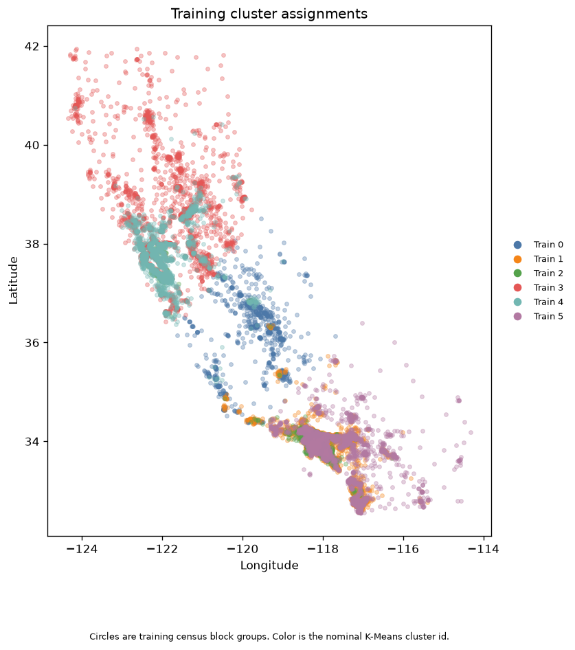
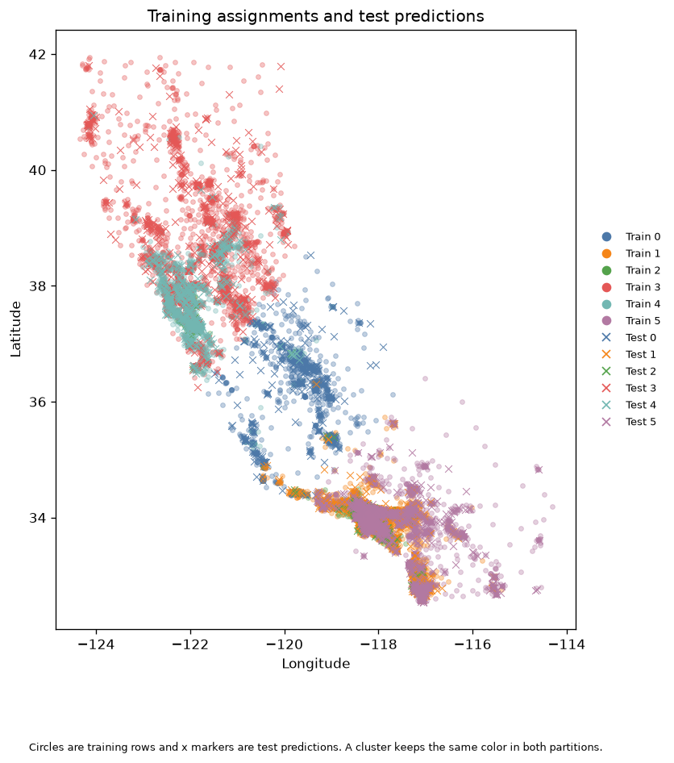
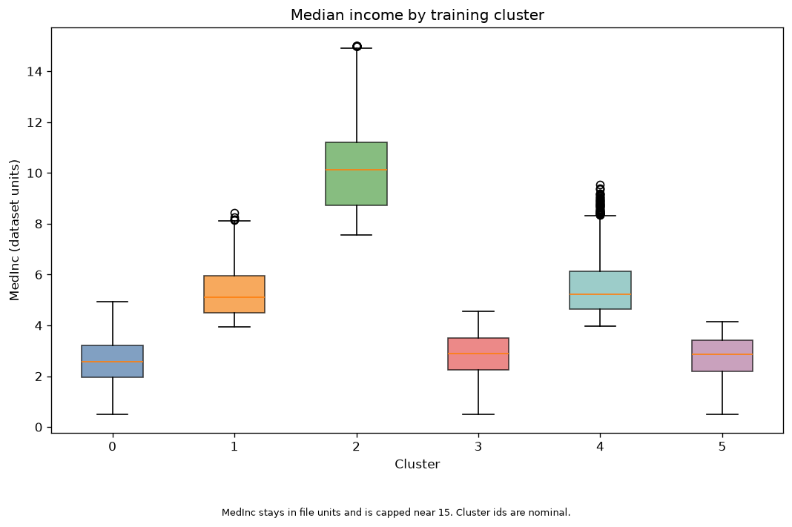
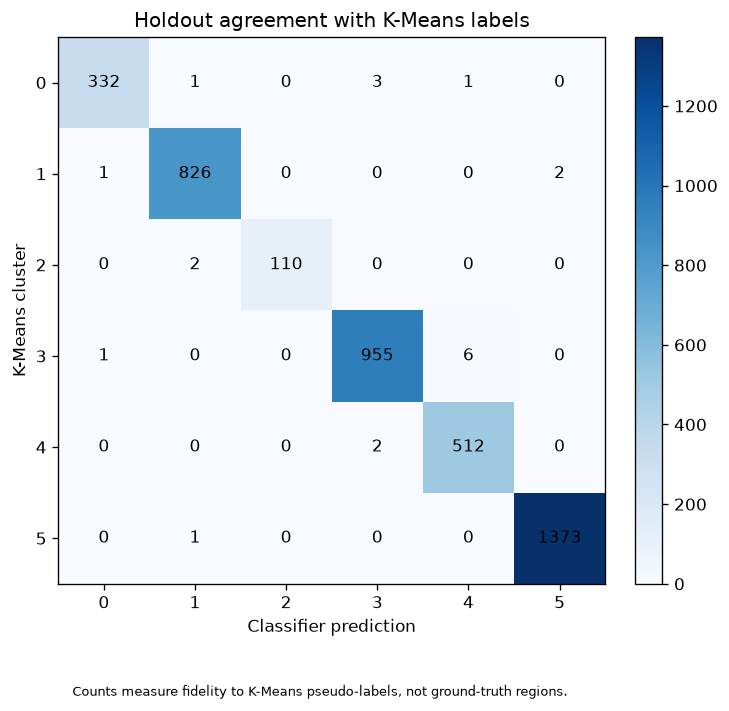

# California Housing Area Groups with K-Means

This project groups California census block groups by location and median income, then trains a classifier to reproduce those machine-made group labels.

Each row in `housing.csv` is one census block group from the 1990 census, not one house. The exercise does not predict house value. It shows how an unsupervised model can label data that a supervised model then imitates.

The tutorial source is the [4Geeks Academy K-Means project](https://github.com/4GeeksAcademy/k-means-project-tutorial). The canonical dataset URL is:

```text
https://raw.githubusercontent.com/4GeeksAcademy/k-means-project-tutorial/main/housing.csv
```

This repository uses the local copy at `housing.csv`.

## Feature contract

The models use these columns, in this order:

| Position | Column | Meaning |
|---:|---|---|
| 1 | `Latitude` | Latitude of the census block group |
| 2 | `Longitude` | Longitude of the census block group |
| 3 | `MedInc` | Median income in the file's own units |

`MedInc` is left in those file units. In this file it runs from about 0.50 to 15.00, with a cap near 15. Cluster ids `0` through `5` are nominal labels. A higher number is not a higher rank, and the same grouping can receive different numbers if the model is refit without the same seed.

## Setup

Use Python 3.11 or newer. This run used Python 3.13.14.

```bash
python3 -m venv .venv
source .venv/bin/activate
pip install -r requirements.txt
```

## Run

From the repository root:

```bash
python src/app.py
```

Check the workflow contracts with:

```bash
pytest -q
```

`src/app.py` is the reproducible path. `src/explore.ipynb` repeats the loading, clustering, and figures for reading. It does not need to be run in a particular order to reproduce the saved models.

The script does not use the template database connection in `src/utils.py`.

## Split, scaling, and leakage

The validated three-feature table is split before any preprocessing or model is fit.

- 20,640 rows kept
- 5 duplicate three-feature rows kept and reported
- 0 coordinate flags (latitude outside -90 to 90, or longitude outside -180 to 180)
- Training rows: 16,512
- Test rows: 4,128
- `test_size=0.20`, `random_state=42`, `shuffle=True`
- No stratification, because cluster labels do not exist yet

`StandardScaler` is fit on the training rows only. K-Means is fit on those scaled training rows only. Test rows are transformed and labeled with that same fitted pipeline.

K-Means uses six clusters because the tutorial requires six. The setting is not replaced when another cluster count might score differently.

```text
n_clusters=6
init=k-means++
n_init=10
random_state=42
```

This run converged in 29 iterations. Training inertia was 8069.19.

## What the six clusters show

Profiles below use the training rows. Medians describe the rows in each cluster. Centroids are the cluster centers after they are converted back to the original units. A centroid may not be a real census block group, and the clusters do not have to be the same size.

| Cluster | Train rows | Train % | Test rows | Median latitude | Median longitude | Median MedInc | Centroid (lat, lon, MedInc) |
|---:|---:|---:|---:|---:|---:|---:|---|
| 0 | 1,321 | 8.0 | 337 | 36.30 | -119.71 | 2.56 | 36.08, -119.73, 2.62 |
| 1 | 3,380 | 20.5 | 829 | 33.92 | -118.04 | 5.10 | 33.87, -118.02, 5.31 |
| 2 | 453 | 2.7 | 112 | 34.11 | -118.43 | 10.12 | 34.89, -119.23, 10.43 |
| 3 | 3,931 | 23.8 | 962 | 38.01 | -121.98 | 2.89 | 38.35, -121.90, 2.84 |
| 4 | 2,239 | 13.6 | 514 | 37.68 | -122.02 | 5.22 | 37.70, -121.94, 5.52 |
| 5 | 5,188 | 31.4 | 1,374 | 33.97 | -118.07 | 2.85 | 33.82, -117.82, 2.78 |

Relative to the training medians:

- Clusters 3 and 4 sit farther north and farther west. Cluster 4 has higher median income. Cluster 3 has lower median income and its rows extend farther north.
- Cluster 0 sits between those northern groups and the southern groups. Its median income is lower.
- Clusters 1 and 5 sit farther south and farther east. They overlap on the map. Cluster 1 has higher median income, and cluster 5 has lower median income. Cluster 5 is the largest group.
- Cluster 2 is a small southern group with much higher median income. Its income distribution reaches the file's cap near 15.

Farther west in this California dataset is toward the coast, and farther east is inland. The map overlap is expected: two block groups can share a location and still fall in different clusters when their median incomes differ.







Test markers land on the same geographic regions as the training points of the same color. That is a visual check of the shared label mapping, not proof of a real-world boundary.

## Supervised imitation

The classifier sees the same three raw features and learns the integer cluster id produced by the training-fitted K-Means pipeline. Candidates were compared with the same 5-fold stratified cross-validation on the training labels. The winner is the highest mean macro F1. A tie would keep the simpler model, in this order: logistic regression, decision tree, random forest.

| Candidate | Mean accuracy | Accuracy std | Mean macro F1 | Macro F1 std |
|---|---:|---:|---:|---:|
| Logistic regression | 0.9901 | 0.0018 | 0.9834 | 0.0045 |
| Decision tree | 0.9915 | 0.0016 | 0.9871 | 0.0032 |
| Random forest | 0.9939 | 0.0007 | 0.9905 | 0.0011 |

The selected model is the random forest. Logistic regression already agrees closely with K-Means, which fits clusters that have linear boundaries in scaled space. The forest was a little more faithful on the training folds, so the selection rule keeps it. The final forest is refit on all 16,512 training rows. The test rows were not used to choose it.

Holdout agreement with the K-Means labels:

| Metric | Score |
|---|---:|
| Accuracy | 0.9952 |
| Balanced accuracy | 0.9920 |
| Macro precision | 0.9948 |
| Weighted precision | 0.9952 |
| Macro recall | 0.9920 |
| Weighted recall | 0.9952 |
| Macro F1 | 0.9934 |
| Weighted F1 | 0.9952 |

Every test cluster has support. Cluster 5 is the easiest to imitate (F1 0.9989, support 1,374). Cluster 0 is the hardest (F1 0.9896, support 337). The largest off-diagonal counts are 6 rows of cluster 3 predicted as cluster 4, and 3 rows of cluster 0 predicted as cluster 3. Those pairs sit near each other geographically and differ more by income.



These scores measure how closely the classifier reproduces K-Means labels. They are not accuracy against human-labeled regions. The project has no ground-truth region or socioeconomic class labels.

## Saved artifacts

| File | Contents |
|---|---|
| `models/kmeans_pipeline.joblib` | Training-fitted scaler and six-cluster K-Means model |
| `models/supervised_classifier.joblib` | Random forest refit on the training cluster labels |
| `models/model_metadata.json` | Source, split, profiles, metrics, and package versions |
| `data/processed/housing_train_clustered.csv` | Training features plus integer `cluster` |
| `data/processed/housing_test_clustered.csv` | Test features plus integer `cluster` |

Reload both joblib files and predict the same sample before treating them as usable. This run did that, and the reloaded predictions matched the predictions made before saving.

Joblib uses pickle. Load these files only from a trusted source, with compatible package versions. The saved files are not a substitute for the training code.

Versions for this run:

- Python 3.13.14
- pandas 3.1.1
- NumPy 2.5.4
- scikit-learn 1.9.1
- joblib 1.6.0

## Limitations

- The cluster labels were created by K-Means. They are not verified social, economic, or policy categories.
- Six clusters are a tutorial requirement.
- Longitude and latitude alone do not show the income split. Read the income plot with the map.
- Five repeated three-feature rows were kept because a repeated census record is not automatically an error.
- `MedHouseVal` and the other housing columns are not model inputs.

## Course delivery

After review, commit the project, push it to the learner repository, and submit that repository link through 4Geeks.com. Pushing and submitting need the learner's own authorization and credentials.
